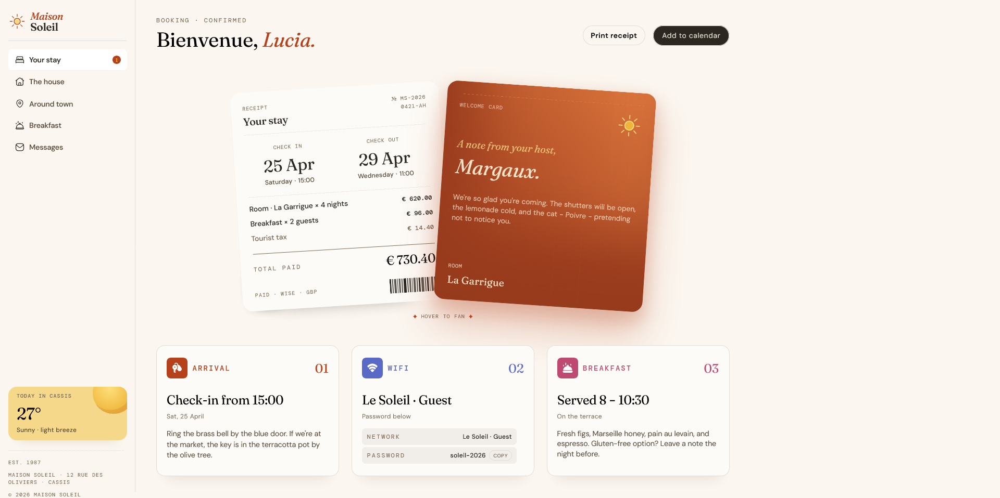

# Frontend Mentor - Hotel booking confirmation page solution

This is a solution to the [Hotel booking confirmation page challenge on Frontend Mentor](https://www.frontendmentor.io/challenges/hotel-booking-confirmation-page). Frontend Mentor challenges help you improve your coding skills by building realistic projects. 

## Table of contents

- [Overview](#overview)
  - [The challenge](#the-challenge)
  - [Screenshot](#screenshot)
  - [Links](#links)
- [My process](#my-process)
  - [Built with](#built-with)
  - [Continued development](#continued-development)
- [Author](#author)

## Overview

### The challenge

Build a page that looks identical to [design/desktop-design.jpg](design/desktop-design.jpg). The window width you should work with is 1440 × 978 pixels.

### Screenshot

### Links

- Solution URL: [Netlify](https://zippy-faloodeh-773c93.netlify.app)

## My process

### Built with

- Semantic HTML5 markup
- Flexbox

### Continued development

In future projects, I want to focus on improving my responsive design skills. Although this project closely matches the provided desktop design, it does not yet adapt to different screen sizes. I plan to practise using media queries and flexible layouts to make my webpages responsive and ensure they look good on desktops, tablets, and mobile devices.

## Author

- lokyi7647647 [GitHub](https://github.com/lokyi7647647)
